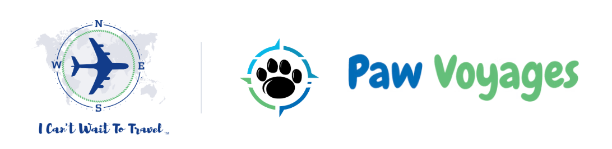
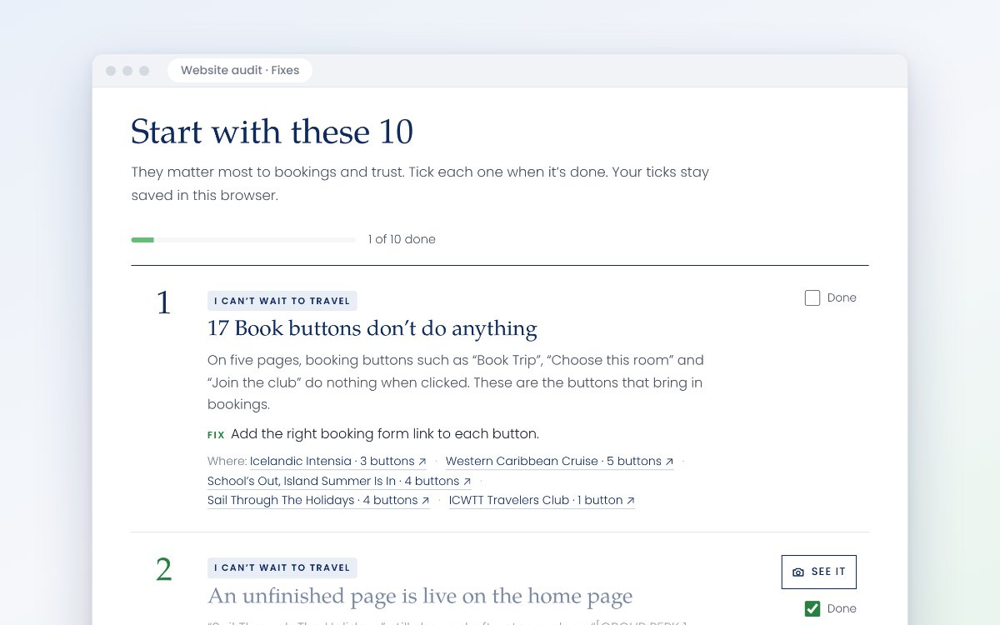
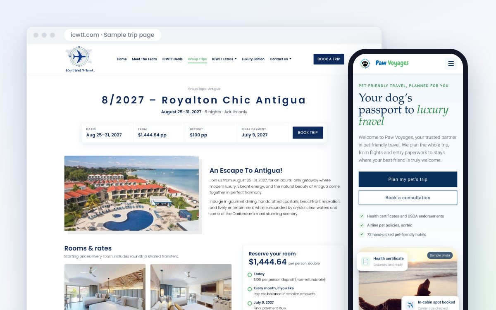
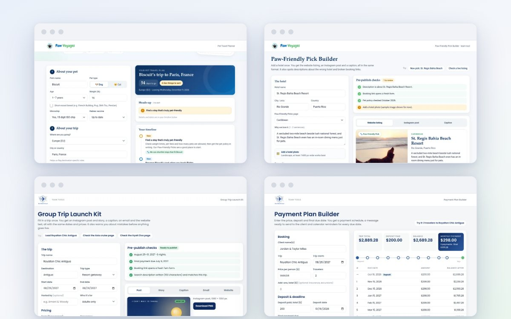
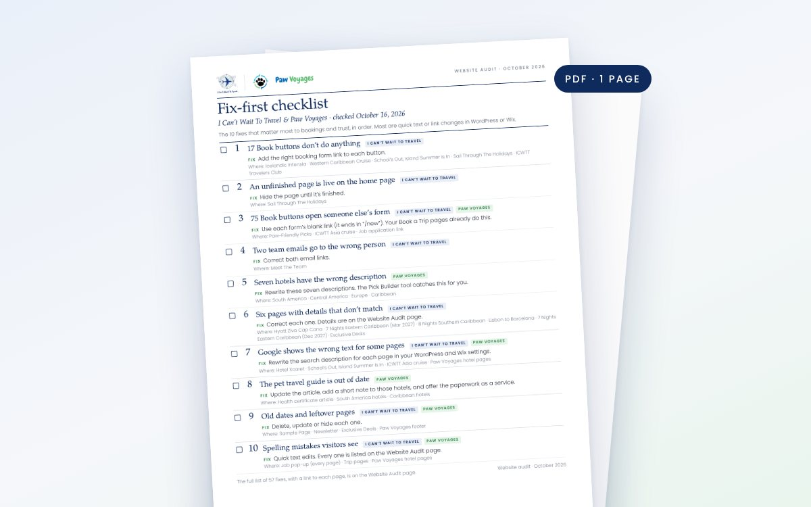

  

<h1 align="center">Website ideas and fixes</h1>

  Everything for your websites, in one place. 
  <a href="index.html"><b>Open it here →</b></a>

Works on any phone or computer. Nothing to install and no login.

---

## What’s inside

Four things to help more visitors book with I Can’t Wait To Travel and Paw Voyages. Short on time? Start with number 1.

### 1. Website fixes

**What it is:** 57 things to fix across your four websites, with the 10 that matter most at the top. Each one says what’s wrong, how to fix it and which page it’s on.

**How it helps:** Book buttons that work and details people can trust mean fewer lost bookings. Most fixes are quick text or link changes, and you can tick each one off as you go.

**[Open the fixes →](website-audit.html#fixes)**

### 2. Two sample pages

**What it is:** Your Royalton Chic Antigua trip page and the Paw Voyages home page, redesigned. Switch to “Today” to compare each one with the live page.

**How it helps:** Shows how a page can answer people’s questions up front and make it easy to book or get in touch. Use the trip page as the template for every trip.

**[See the sample pages →](website-audit.html#ideas)** 
Or open them full size: [trip page](samples/icwtt-trip-page.html) · [Paw Voyages home page](samples/paw-voyages-home.html)

### 3. Four time-saving tools

**What it is:** Simple forms that turn a few details into finished work: Instagram posts and captions, emails, website text, payment plans and pet travel checklists.

**How it helps:** Saves your team time on work you repeat for every trip and every hotel. Two of them also catch mistakes, like wrong dates and broken links, before anything goes live.

- **[Pet Travel Planner](tools/pet-travel-planner.html)**, for Paw Voyages clients: a dated checklist for vaccines, vet visits and travel forms.
- **[Paw-Friendly Pick Builder](tools/paw-pick-builder.html)**, for the Paw Voyages team: the website listing, an Instagram post and a caption for each hotel.
- **[Group Trip Launch Kit](tools/trip-launch-kit.html)**, for the I Can’t Wait To Travel team: an Instagram post and story, a caption, an email and the website text for each trip.
- **[Payment Plan Builder](tools/payment-plan.html)**, for the I Can’t Wait To Travel team: a monthly plan, a message for the client and calendar reminders.

**[Open the tools →](website-audit.html#tools)**

### 4. Printable checklist

**What it is:** The 10 most important fixes on one page, with a box to tick for each.

**How it helps:** Print it or send it to whoever updates your websites, so everyone works from the same list.

**[Open the checklist (PDF) →](assets/downloads/website-audit-checklist.pdf)**

---

## Good to know

- Nothing here changes your live websites, so it’s safe to click around.
- Some photos in the sample pages and tools are stand-ins. Swap in your own any time.
- To keep a copy, click the green **Code** button at the top of this page, then **Download ZIP**. Unzip it and open `index.html` in any web browser.
